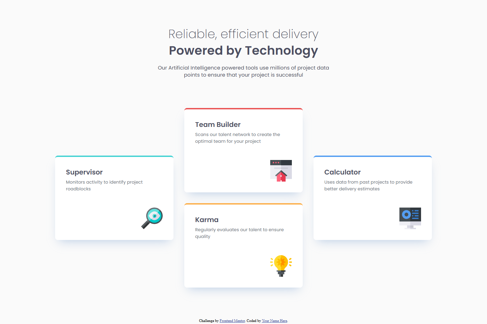
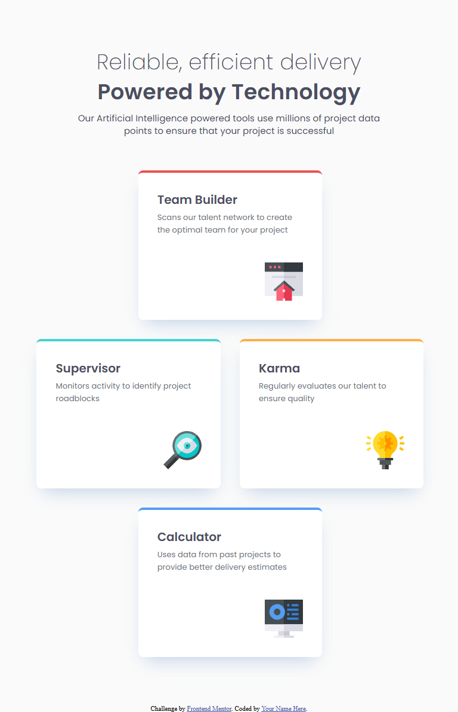
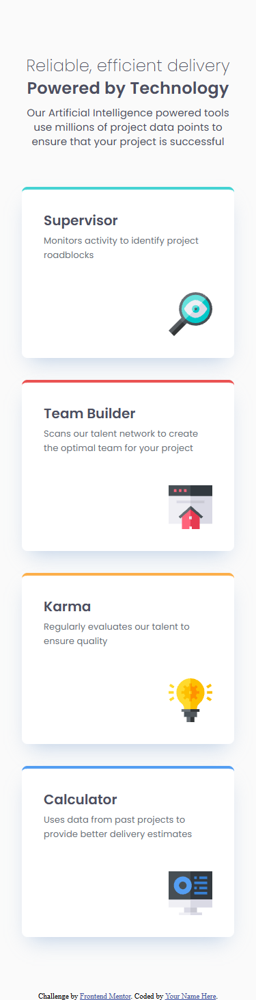

# Frontend Mentor - Four card feature section solution

This is a solution to the [Four card feature section challenge on Frontend Mentor](https://www.frontendmentor.io/challenges/four-card-feature-section-weK1eFYK). Frontend Mentor challenges help you improve your coding skills by building realistic projects. 

## Table of contents

- [Frontend Mentor - Four card feature section solution](#frontend-mentor---four-card-feature-section-solution)
	- [Table of contents](#table-of-contents)
	- [Overview](#overview)
		- [The challenge](#the-challenge)
		- [Screenshot](#screenshot)
		- [Links](#links)
	- [My process](#my-process)
		- [Built with](#built-with)
		- [What I learned](#what-i-learned)
		- [Continued development](#continued-development)
		- [Useful resources](#useful-resources)
	- [Author](#author)

## Overview

This layout challenge proved trickier than I originally expected, but in some ways, it was also easier. I had planned to create two solutions: one using grid and the other using flexbox. I have little experience with grid and generally prefer flexbox, even for 3D layouts, which can be achieved by nesting flex containers. However, that approach did not seem possible for this challenge.

For clarity, I had hoped to use an approach like the code below to create the layout with flexbox. The problem is the card order in the tablet view: the cards need to be rearranged in a way that does not work with the nested flex containers.
```html
<section class="cards">
	<div class="card"></div>
	<section class="inner-flex">
		<div class="card"></div>
		<div class="card"></div>
	</section>
	<div class="card"></div>
</section>
```
```css
.cards {
	display: flex;
	flex-direction: column;
}

.inner-flex {
	display: flex;
	flex-direction: row;
}

@media screen and (min-width: 1100px) {
	.cards {
		display: flex;
		flex-direction: row;
	}

	.inner-flex {
		display: flex;
		flex-direction: column;
	}
}
```

This meant I had to use grid, which I find more complicated to keep track of. However, it also meant I did not need to create two separate solutions, making the process easier. In the end, I gained more experience with grid, which was valuable because it is sometimes necessary.

### The challenge

Users should be able to:

- View the optimal layout for the site depending on their device's screen size

### Screenshot
- Desktop View 
- Tablet View  
  
- Mobile View  
  

### Links

- Solution URL: [GitHub Repository](https://github.com/kkanit22/FEM-2-2-four-card-feature-page)
- Live Site URL: [Live Site](https://kkanit22.github.io/FEM-2-2-four-card-feature-page/)

## My process

### Built with

- Semantic HTML5 markup
- CSS custom properties
- CSS Grid
- Mobile-first workflow

### What I learned

As noted in the Overview section, I found this challenge to be an example of a 3D layout that requires grid. Completing it gave me a chance to refresh my understanding of how grid works. It also helped me appreciate the flexibility grid offers when reordering components for different layouts.

### Continued development

I hope to find more opportunities where grid is the better choice for a layout and to learn how to use it more dynamically.

### Useful resources

- [MDN Playground for Grid](https://developer.mozilla.org/en-US/play?uuid=d09a94e9bfb3d6e8d521dfa0c2b5f4b1a9663231&state=jZJPb%2BMgEMW%2FymiqSmllN3b%2BqCnt%2BtjrHrZHX3AgDq0NCHDMbtXvvsImiup1pD2BmPd7bxjNJx5d2yDBFyZOsG%2BotT9K7A3VmpsSi1ICfCspyUssfkr%2BsmTi9G%2Fd9arE4q1X1%2BpHw4PDWzivaA6qC9mvqjPXFOIUTF7F6ZqHFb7E4pfw5%2Fr5xAT31iLBe%2FgMVKV8asUfIWsClTKMm7RS%2FrmUX6V8iIMYlS31aS%2BYOxJ42mQ6aMKjqYUkkAHtnJpgBYSWYkywJrDSHqxqBANTV4vVeg35Yw673d3zRZUaykRnCWxjSEX3H7VRnWTpXjXKkAkMS9hmt6OFpowNn8l5OzxE4oY9bXbZYe5jTFjd0N8EaiPYwIRL6nirG%2Bp4yOxaaQkYrjl1i3UC%2BcGMcTXVBPLzNAYuDCI1qrcEWiFb6hd5lmmfDBO6iw0oycfwARkTCOSwhPXFyaieQB4J16sZYgVL2EyJ6DJQYc%2FmkiZM8NlGJuzfDDJt7BwRlnGus4l8E%2BVW%2BP8wj2pM8D0sKybojrzlSJBR84FffwE%3D&srcPrefix=%2Fen-US%2Fdocs%2FWeb%2FCSS%2FGuides%2FGrid_layout%2F) - This provides a prebuilt grid layout that you can study and alter as needed to quickly learn grid through practical example.
- [MDN CSS grid layout](https://developer.mozilla.org/en-US/docs/Web/CSS/Guides/Grid_layout) - While there are many other sites that offer grid tutorials, I found that between the api guide here and the playground they provide I was able to get what I needed to get this working quickly.

## Author

- Frontend Mentor - [@kkanit22](https://www.frontendmentor.io/profile/kkanit22)